# DV-ONE — Aviation Institute Management Suite

DV-ONE is a Java desktop application project designed to organize the academic and administrative operations of an aviation training institute. It brings cadet records, batches, attendance, fee tracking, staff information, ID cards, certificates and system configuration into one management suite.

The interface uses a dark, aviation-inspired visual theme with a centralized navigation desk and dedicated workspaces for institute operations.

> **Project status:** Portfolio / academic project. Screenshots show the application interface and example records. They do not, by themselves, establish that every workflow is production-ready. Confirm the implementation status of each feature against the current source code before making release or deployment claims.

## Application Preview

### Dashboard

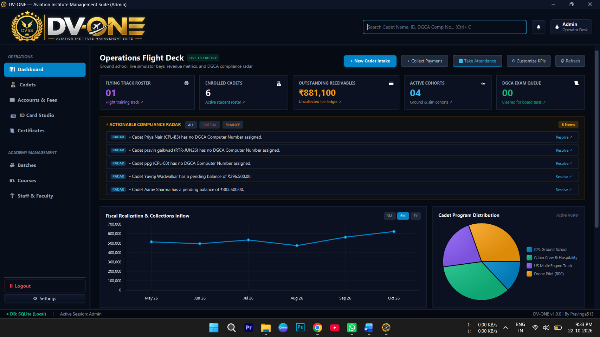

### Cadet Management

| Cadet directory | Cadet dossier |
|---|---|
| 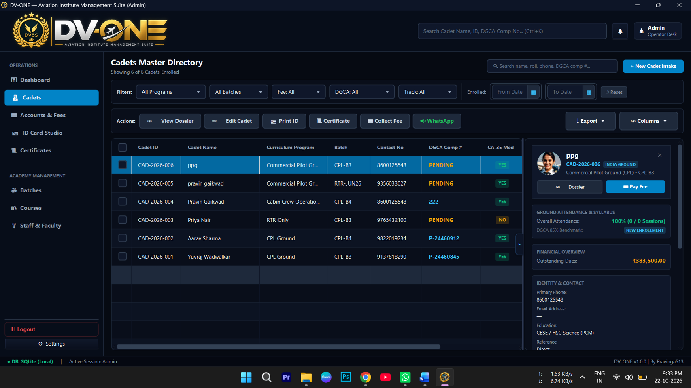 | 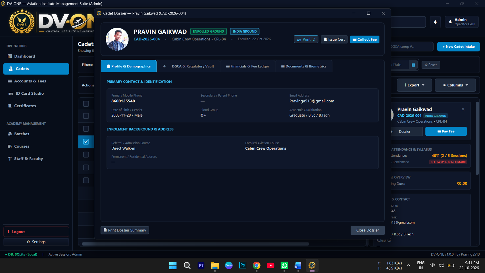 |

### Batches and Attendance

| Batch and roster management | Attendance register |
|---|---|
| 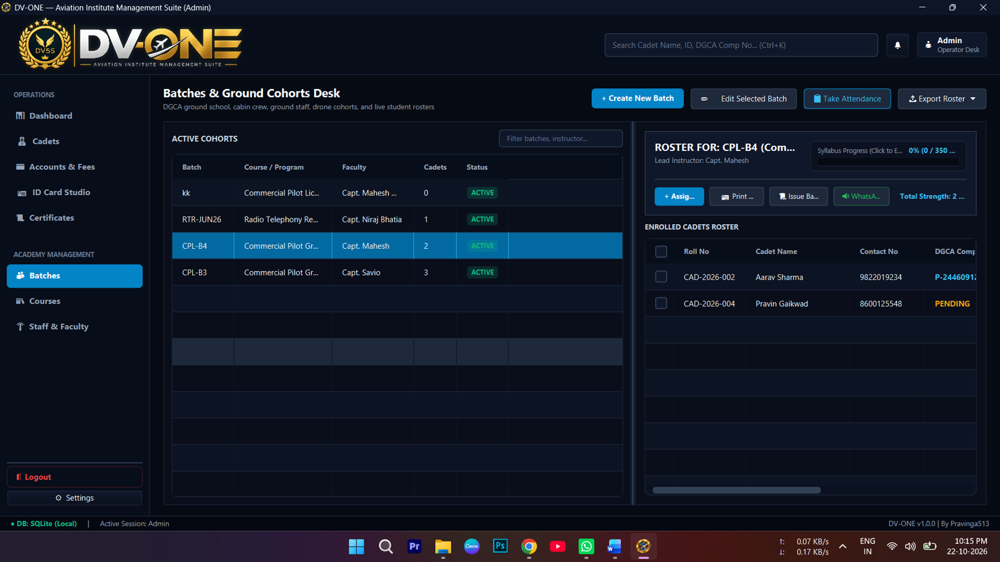 | 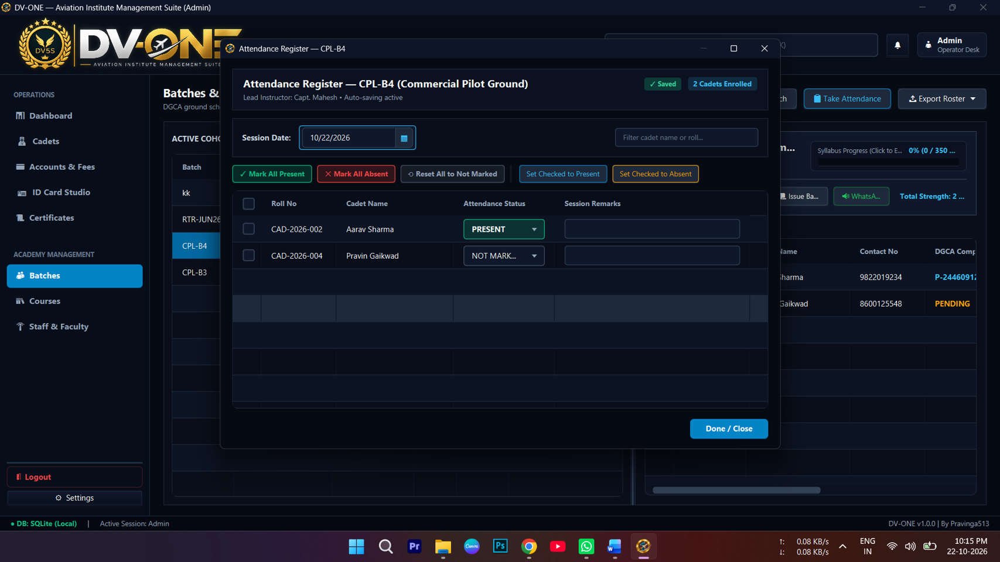 |

### Accounts and Staff

| Accounts and fee ledger | Staff and faculty |
|---|---|
| 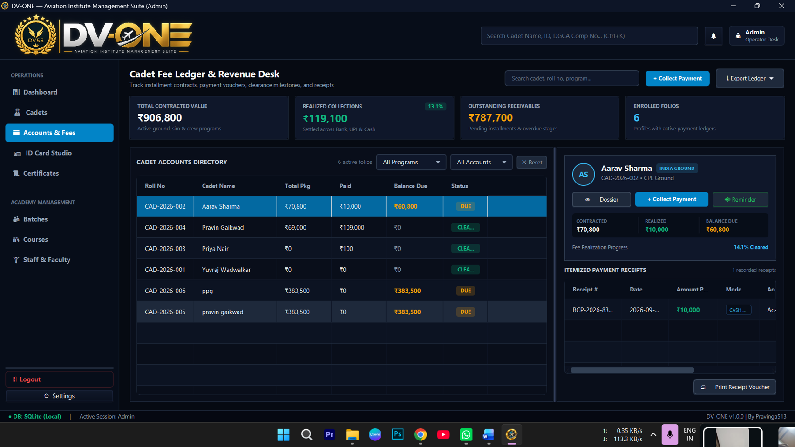 | 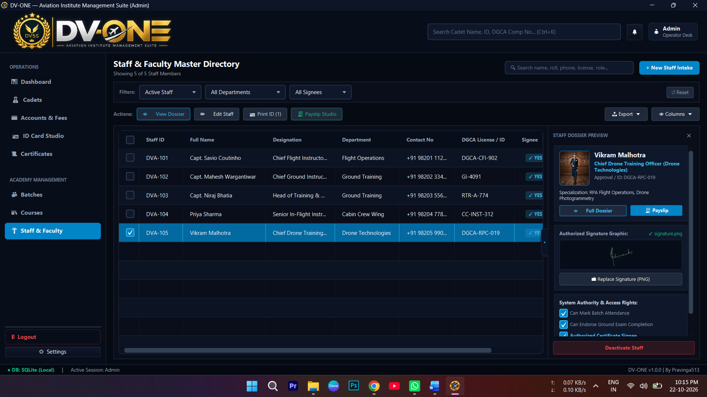 |

### ID Card Studio

| ID card design studio | ID card print preview |
|---|---|
| 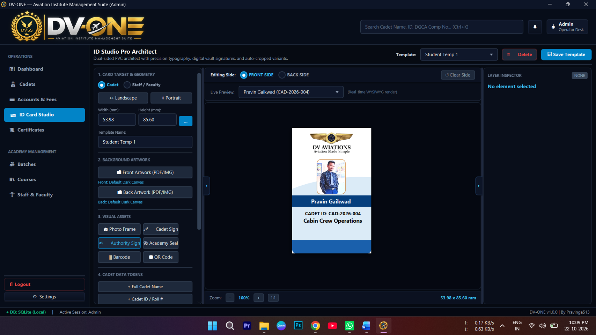 | 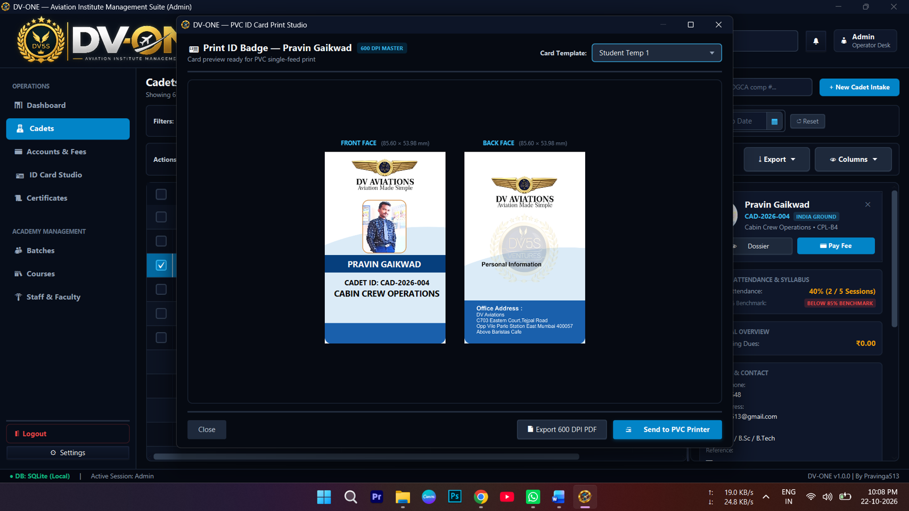 |

### Certificate Management

| Certificate registry | Certificate template studio |
|---|---|
| 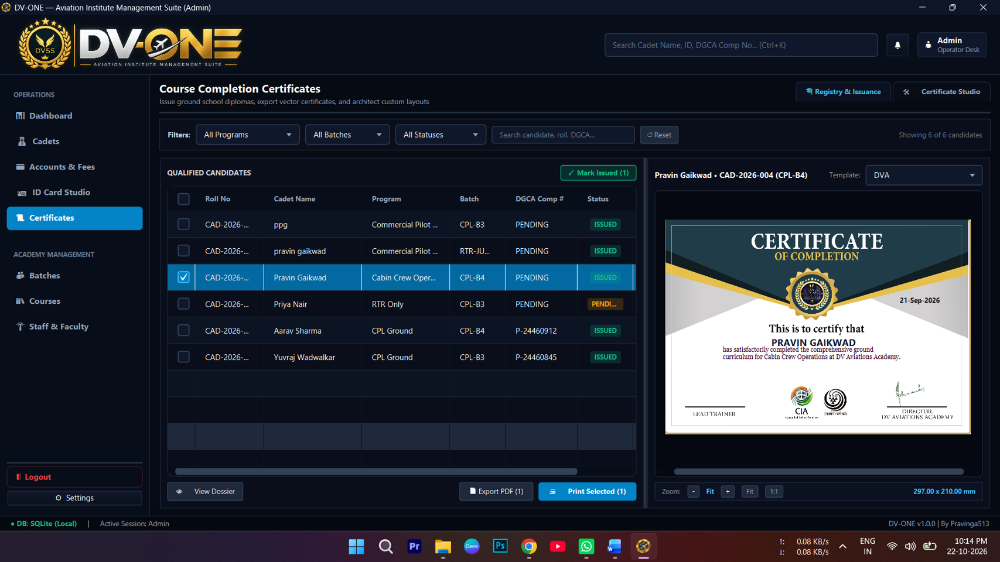 | 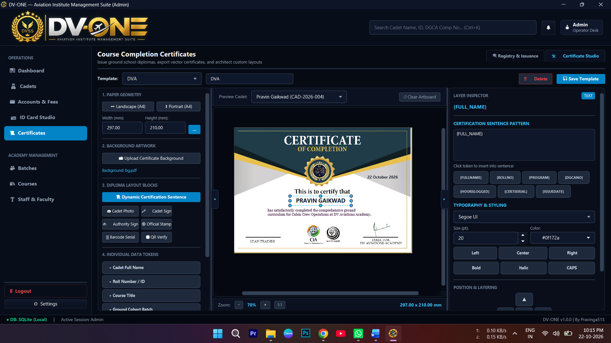 |

### System Configuration

| Configuration profile | Brand assets and signatories |
|---|---|
| 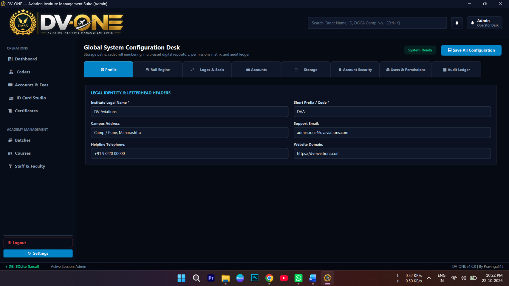 | 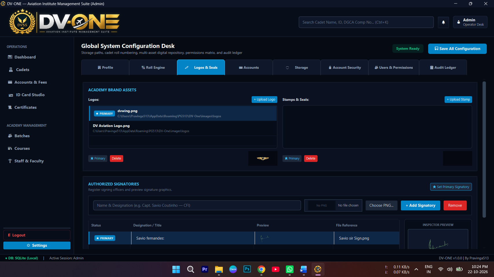 |

### Audit Ledger

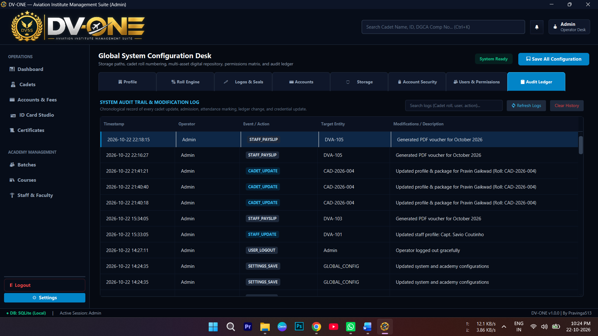

### Login

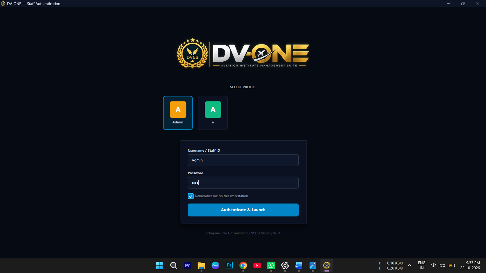

## Key Areas

Based on the screens shown in this repository, the application includes these workspaces:

- **Dashboard** — operational overview, enrolled cadets, active cohorts, receivables, compliance reminders and visual summaries.
- **Cadets** — cadet directory, filters, profile details, dossier view and quick actions.
- **Accounts & Fees** — fee ledger, contracted amounts, collections, outstanding balances and payment receipts.
- **ID Card Studio** — editable card templates, front/back layouts, visual assets and print preview.
- **Certificates** — certificate registry, issuance status, template selection and certificate layout studio.
- **Batches** — cohort management, course and faculty assignment, enrolled cadet roster and attendance.
- **Staff & Faculty** — staff directory, roles, departments, signatories and staff dossier preview.
- **System Settings** — institute profile, roll-number configuration, logos and seals, accounts, storage, security, users and permissions, and audit ledger.

## Technology

The project documentation identifies the following stack:

| Area | Technology |
|---|---|
| Language | Java |
| Desktop UI | JavaFX |
| UI markup | FXML |
| UI styling | CSS |
| Local database | SQLite |
| Build | Apache Maven |

Update this list if the current `pom.xml` or source code uses a different version or additional libraries. Avoid listing dependencies that are not actually included in the repository.

## Getting Started

### Prerequisites

- JDK version required by the project configuration
- Apache Maven
- Windows desktop environment (as shown in the supplied application screenshots)

### Clone the repository

```bash
git clone <YOUR-REPOSITORY-URL>
cd <YOUR-REPOSITORY-FOLDER>
```

### Build

```bash
mvn clean package
```

### Run

Use the run configuration documented in the repository. If the Maven JavaFX plugin is configured, the command may be:

```bash
mvn javafx:run
```

If this command is not configured, use the launch method specified by the project's `pom.xml` and source documentation.

## Repository Screenshots

All application screenshots are stored in [`docs/screenshots/`](docs/screenshots/). They are embedded above and can also be opened individually from that folder.

## Author

**Pravin Gaikwad**

- LinkedIn: [pravinga513](https://www.linkedin.com/in/pravinga513/)
- Website: [pg513.in](https://pg513.in)
- GitHub: [@pravinga513](https://github.com/pravinga513)

## Before Publishing

The supplied screenshots visibly contain example names, contact details, email addresses, institute information and financial figures. **Review and redact any real or confidential personal, student, staff or business information before making this repository public.** Prefer synthetic demo records for public portfolio screenshots.

Do not upload database files containing real records, credentials, API keys, private documents or other confidential assets.

---

*DV-ONE — Aviation Institute Management Suite*
